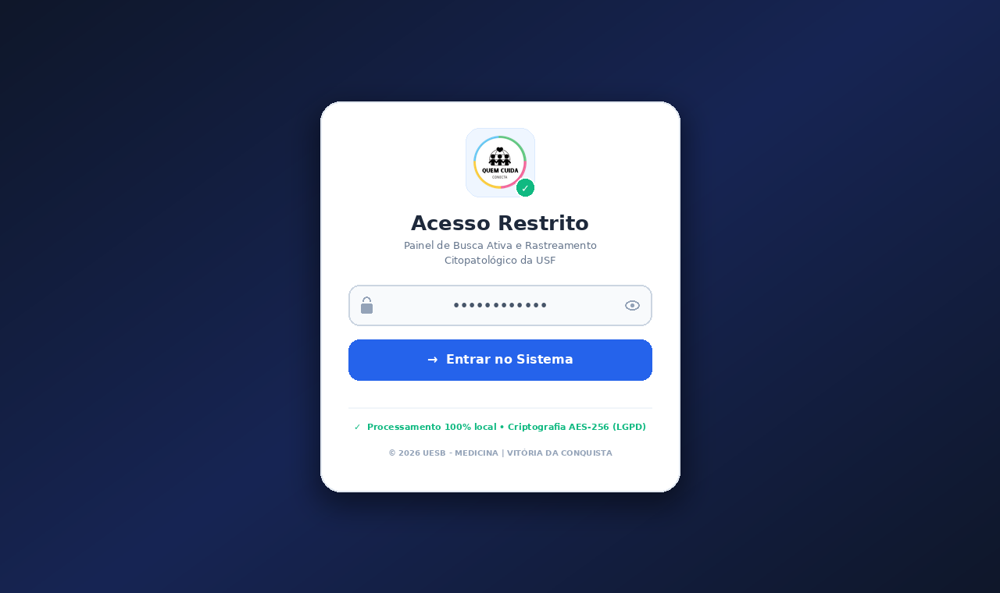
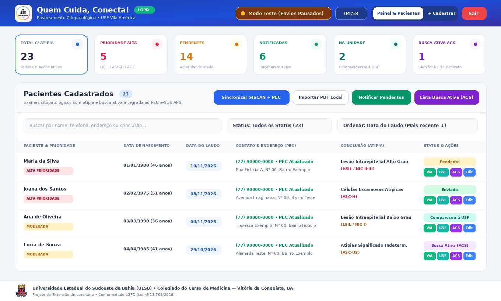
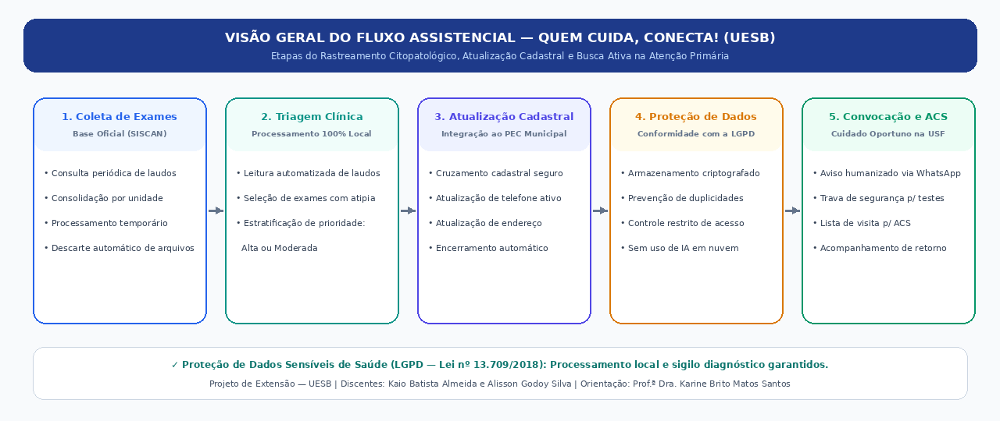
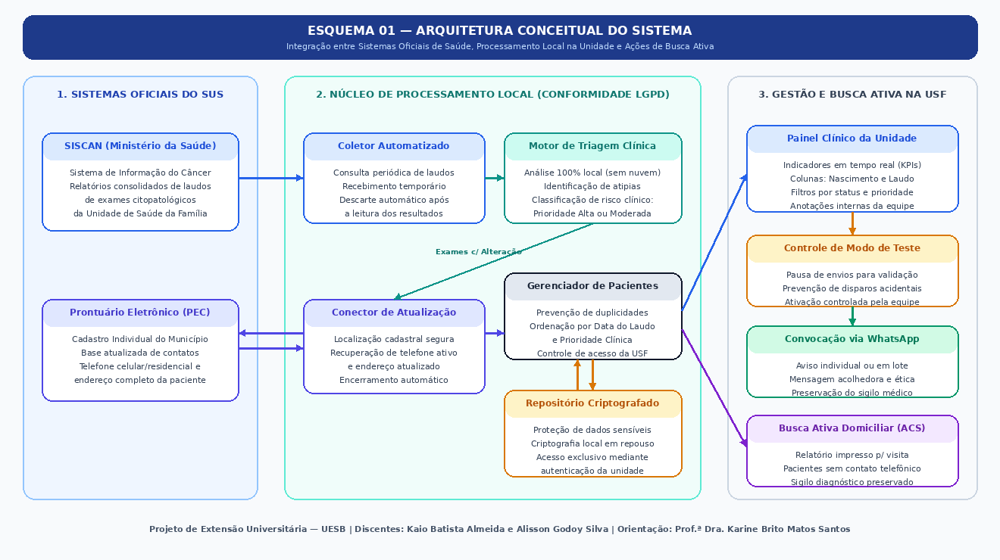
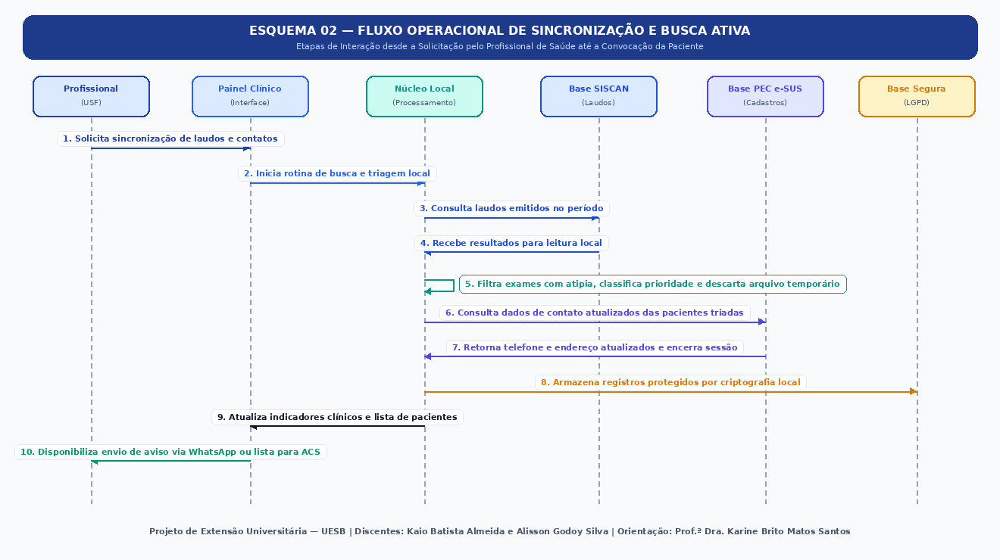

# Quem Cuida, Conecta!

**Sistema de Apoio ao Rastreamento Citopatológico, Atualização Cadastral e Busca Ativa na Atenção Primária à Saúde**

[-0d9488?style=for-the-badge)](#principais-funcionalidades)

---

## Sobre o Projeto de Extensão Universitária (UESB)

O **Quem Cuida, Conecta!** é uma iniciativa acadêmica e tecnológica desenvolvida no âmbito de um **Projeto de Extensão Universitária** vinculado ao **Colegiado do Curso de Medicina da Universidade Estadual do Sudoeste da Bahia (UESB)**, campus de **Vitória da Conquista – BA**, direcionada ao fortalecimento do cuidado na **Unidade de Saúde da Família (USF) Vila América**.

<table>
  <tr>
    <td align="center" width="120">
      
    </td>
    <td align="left">
      <strong>Instituição:</strong> Universidade Estadual do Sudoeste da Bahia (UESB) 
      <strong>Curso / Departamento:</strong> Medicina — Campus de Vitória da Conquista, Bahia 
      <strong>Discentes Autores:</strong> Kaio Batista Almeida e Alisson Godoy Silva 
      <strong>Docente Orientadora:</strong> Prof.ª Dra. Karine Brito Matos Santos 
      <strong>Cenário de Prática:</strong> Atenção Primária à Saúde — USF Vila América
    </td>
  </tr>
</table>

### Contexto e Motivação em Saúde Pública

O rastreamento periódico por meio do exame citopatológico do colo do útero (Papanicolaou) é a principal estratégia do Sistema Único de Saúde (SUS) para a detecção precoce de lesões precursoras do câncer cervical. Entretanto, na rotina das Unidades de Saúde da Família, o seguimento efetivo das mulheres examinadas enfrenta três desafios recorrentes após a liberação dos resultados laboratoriais:

1. **Identificação manual de exames alterados**: a equipe de saúde precisa revisar extensos relatórios consolidados no **SISCAN** para localizar os laudos que apresentam alterações celulares e demandam retorno prioritário.
2. **Desatualização de contatos**: frequentemente, os telefones e endereços informados no momento da requisição do exame estão desatualizados, dificultando a convocação oportuna da paciente.
3. **Articulação da Busca Ativa**: quando o contato telefônico não é possível, torna-se indispensável organizar rapidamente a visita domiciliar pelos **Agentes Comunitários de Saúde (ACS)** com o endereço atualizado da paciente.

O **Quem Cuida, Conecta!** foi concebido para otimizar esse fluxo assistencial na Atenção Primária, integrando a triagem de resultados, a atualização cadastral junto ao **Prontuário Eletrônico do Cidadão (PEC e-SUS APS)** e a comunicação humanizada com as pacientes, em estrita observância à **Lei Geral de Proteção de Dados Pessoais (LGPD — Lei nº 13.709/2018)**.

---

## Ilustrações da Aplicação

### 1. Tela de Acesso Restrito

O acesso ao sistema é exclusivo para profissionais autorizados da unidade de saúde, contando com bloqueio automático de sessão por inatividade e mecanismos locais de proteção de dados:

  
  
<em>Figura 1 — Tela de autenticação restrita da unidade de saúde.</em>

---

### 2. Painel Clínico de Indicadores e Busca Ativa

A interface principal reúne cartões de indicadores clínicos (KPIs), estratificação automática de prioridade (**Alta** ou **Moderada**), visualização independente para **Data de Nascimento** (com cálculo de idade) e **Data do Laudo**, situação de contato atualizado via **PEC**, chave de segurança de **Modo de Teste (Envios Pausados)** e atalhos para registro de comparecimento ou encaminhamento à busca ativa:

  
  
<em>Figura 2 — Painel principal de gerenciamento e acompanhamento de pacientes (ilustração com dados fictícios).</em>

---

## Esquemas Funcionais da Aplicação

### Visão Geral do Fluxo Assistencial

  
  
<em>Figura 3 — Etapas do fluxo assistencial: da coleta de resultados até a convocação da paciente ou visita domiciliar pelo ACS.</em>

### Esquema 1: Arquitetura Conceitual do Sistema

  
  
<em>Figura 4 — Organização conceitual em três blocos: Sistemas Oficiais do SUS, Núcleo de Processamento Local e Gestão na USF.</em>

### Esquema 2: Fluxo Operacional de Sincronização e Busca Ativa

  
  
<em>Figura 5 — Sequência operacional desde a solicitação de sincronização pelo profissional até a convocação da paciente.</em>

---

## Principais Funcionalidades

- **Triagem Automatizada e 100% Local de Laudos**:
  Identifica automaticamente os exames citopatológicos que apresentam atipias celulares em relatórios consolidados, descartando resultados dentro da normalidade sem utilizar serviços externos de Inteligência Artificial em nuvem.
- **Estratificação de Prioridade Clínica**:
  Classifica visualmente os casos em **Prioridade Alta** (lesões de alto grau ou atipias de maior risco que exigem convocação imediata) e **Prioridade Moderada** (alterações de baixo grau ou significado indeterminado), auxiliando a tomada de decisão da equipe médica e de enfermagem.
- **Atualização Cadastral Integrada ao PEC Municipal**:
  Cruza os dados das pacientes triadas com o cadastro municipal para recuperar números de telefone e endereços residenciais atualizados, reduzindo falhas de comunicação.
- **Convocação Humanizada via WhatsApp**:
  Permite o envio individual ou em lote de avisos padronizados e acolhedores, convidando a paciente a comparecer à unidade de saúde sem expor diagnósticos ou resultados clínicos no aplicativo de mensagens.
- **Modo de Teste (Envios Pausados)**:
  Conta com uma trava de segurança diretamente na barra superior que bloqueia disparos reais de mensagens durante treinamentos, demonstrações acadêmicas ou validações pela equipe.
- **Relatório Imprimível para Busca Ativa (ACS)**:
  Gera uma lista formatada para impressão destinada aos Agentes Comunitários de Saúde, contendo os dados de localização das pacientes sem contato telefônico válido e preservando o sigilo diagnóstico.
- **Organização e Acompanhamento de Desfechos**:
  Permite ordenar e filtrar pacientes por **Data do Laudo** (padrão), **Prioridade Clínica**, **Data de Nascimento**, **Nome** ou **Status**, além de registrar rapidamente o comparecimento à USF e observações internas da equipe.

---

## Privacidade, Ética e Conformidade com a LGPD

Por envolver informações vinculadas à saúde no contexto do SUS, o projeto adota diretrizes rigorosas de privacidade e proteção de dados (**Lei nº 13.709/2018 — LGPD**):

- **Processamento Estritamente Local**: nenhuma informação de laudo ou cadastro é transmitida para servidores externos de terceiros ou ferramentas de IA generativa.
- **Armazenamento Protegido**: os dados necessários ao acompanhamento na unidade permanecem criptografados localmente em repouso.
- **Minimização e Descarte de Arquivos Temporários**: relatórios utilizados durante a triagem são removidos automaticamente após o processamento.
- **Preservação do Sigilo Médico**: tanto as notificações enviadas às pacientes quanto as listagens impressas para visitas domiciliares omitem o detalhamento citopatológico do exame, restringindo a informação clínica ao ambiente autenticado da unidade.

---

## Créditos e Autoria Acadêmica

Este software é parte integrante de projeto de extensão da **Universidade Estadual do Sudoeste da Bahia (UESB)** — Colegiado do Curso de Medicina (Vitória da Conquista – BA):

- **Discentes Desenvolvedores**:
  - **Kaio Batista Almeida** — Discente do Curso de Medicina (UESB)
  - **Alisson Godoy Silva** — Discente do Curso de Medicina (UESB)
- **Docente Orientadora**:
  - **Prof.ª Dra. Karine Brito Matos Santos** — Professora do Curso de Medicina (UESB)
- **Unidade de Saúde Parceira**:
  - **Unidade de Saúde da Família (USF) Vila América** — Vitória da Conquista, Bahia
